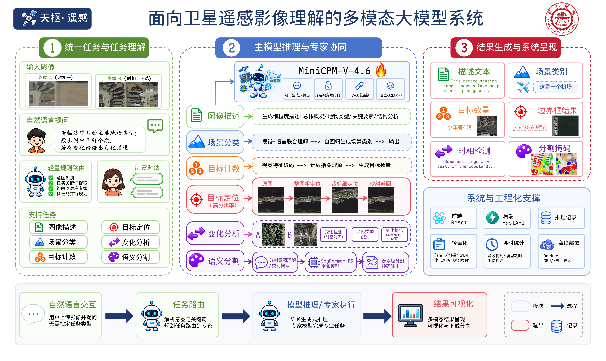
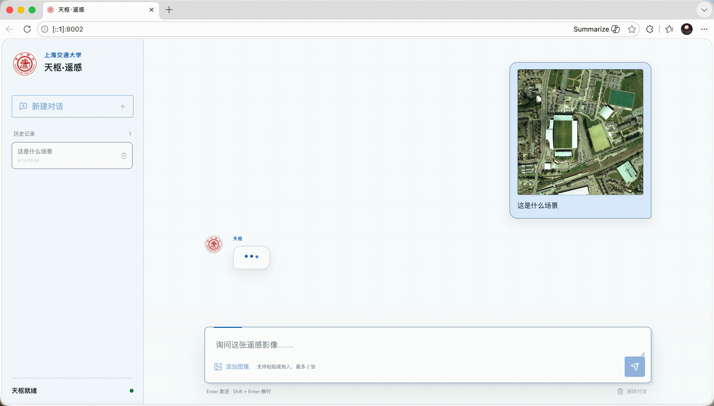
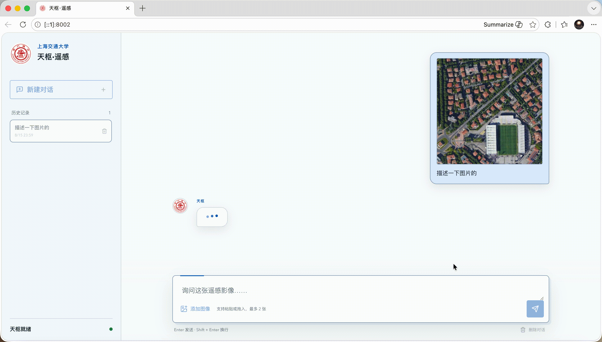
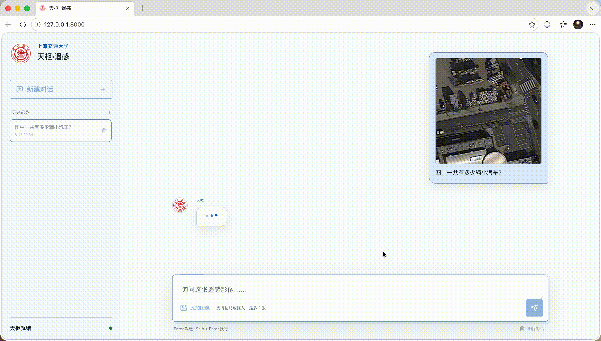
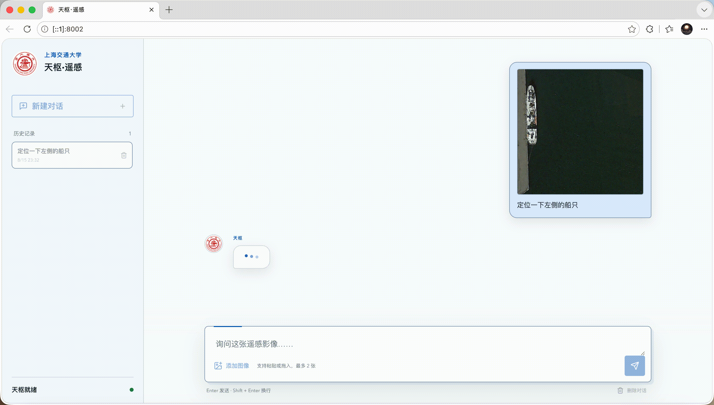
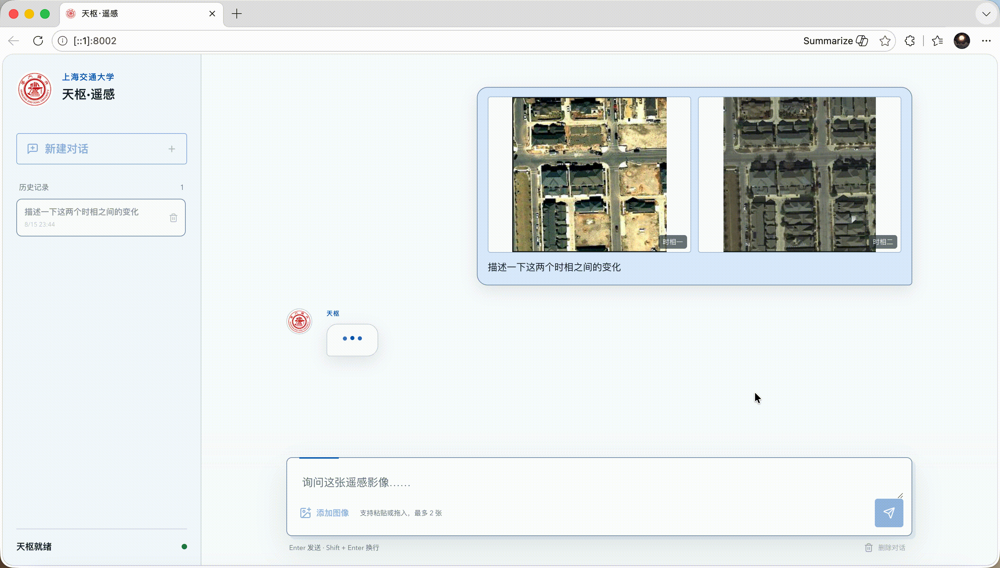
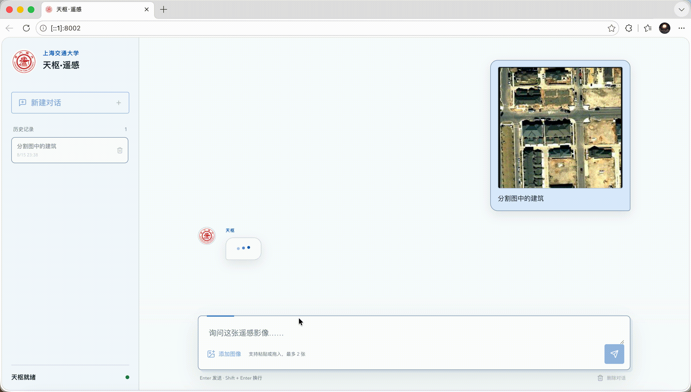

<div align="center">

# 天枢·遥感

### 多模态遥感影像理解系统


[](https://www.python.org/)
[](https://pytorch.org/)
[](models/terrascope/README.md)
[](models/segmentation/README.md)
[](#quick-start)
[](LICENSE)


[Demo](#demo) · [Models](#models) · [Capabilities](#capabilities) · [Quick Start](#quick-start) · [Architecture](#architecture) · [Citation](#citation)

</div>

## News

- **2026-08-30**：发布代码仓库与 TerraScope-1.3B, TerraScope-Segformer 模型权重。

## 项目简介

天枢·遥感是一套轻量化多模态遥感影像理解系统。上传一张或两张遥感图像后，可以直接使用中英文提问，完成场景识别、图像描述、目标计数、视觉定位、时相变化理解和语义分割。

## 功能

- 支持中英文自然语言直接提问。
- 覆盖场景识别、图像描述、目标计数、视觉定位、时相变化理解、视觉问答和语义分割。
- TerraScope 基于 MiniCPM-V 4.6 进行遥感适配，提供合并后的 BF16 权重。
- TerraScope-SegFormer 支持 LoveDA 七类地物的指定类别分割与全场景分割。
- 规则路由优先处理明确分割请求，`<seg>` 与 `<seg_all>` 提供模型侧回退。
- 提供快速、增强和高精定位三档推理；高精定位采用 Top-5 局部候选与两阶段轻量策略选择。
- 提供统一的启动与检查脚本，支持离线运行。


## Architecture



请求首先进入轻量任务路由器。常规视觉语言任务由 TerraScope 处理；语义分割请求交给 SegFormer 模型。规则无法提前确定任务时，TerraScope 仍可通过分割控制词调用同一模型。后端统一解析结果，并按需生成定位框或分割图。

## Models

| 模型 | 骨干网络 | 任务 | 权重格式 | 详情 |
| --- | --- | --- | --- | --- |
| **TerraScope** | MiniCPM-V 4.6，1.3B | 多模态遥感影像理解 | 合并 BF16 Safetensors | [模型卡](models/terrascope/README.md) · [ModelScope](https://modelscope.cn/models/LazySheep006/TerraScope-1.3B) |
| **TerraScope Segmentation** | SegFormer-B5 | LoveDA 七类语义分割 | MMSegmentation Checkpoint | [模型卡](models/segmentation/README.md) · [ModelScope](https://modelscope.cn/models/LazySheep006/TerraScope-Segformer) |

模型架构、训练信息、评估结果与适用范围见各自的模型卡。

高精定位使用的三份轻量权重随代码仓库一同提供：

- `models/precision-selector/adapter_model.safetensors`
- `models/precision-router/top3_policy.pt`
- `models/precision-router/top5_residual_policy.pt`

主模型和语义分割模型体积较大，不写入 Git 历史，请按下方说明下载。

## Capabilities

| 能力 | 图像 | 示例问题 | 执行路径 |
| --- | :---: | --- | --- |
| 场景识别 | 1 | `这张图属于什么遥感场景？` | TerraScope |
| 图像描述 | 1 | `请详细描述这张遥感影像。` | TerraScope |
| 目标计数 | 1 | `图中一共有多少架飞机？` | TerraScope |
| 视觉定位 | 1 | `请定位图中的大型机场。` | TerraScope |
| 时相变化理解 | 2 | `这两个时相之间发生了什么变化？` | TerraScope |
| 指定类别分割 | 1 | `请分割图中的建筑区域。` | TerraScope-SegFormer |
| 全场景分割 | 1 | `请对整张图进行语义分割。` | TerraScope-SegFormer |

定位结果采用 `[0, 1000]` 归一化坐标，后端负责转换并绘制定位框。分割模型支持背景、建筑、道路、水体、裸地、森林和农业用地七类地物。

### Inference Modes

| 模式 | 视觉配置 | 使用场景 |
| --- | --- | --- |
| 快速 | `16x`，最多 9 个切片 | 演示、常规问答和低延迟请求 |
| 增强 | `4x`，最多 9 个切片 | 默认模式，兼顾速度与细节 |
| 高精定位 | Selector `4x/16` Top-5 + 两阶段策略 | 用户显式选择的单图细粒度定位 |

高精定位由用户在界面中显式选择。系统先在整图上选择五个候选区域，再由主模型完成局部定位，并使用两个很小的 CPU 策略网络选择最终候选；双图请求会回退到增强模式。该流程不读取标注，也不会改变主模型权重。

## Demo

<table>
  <tr>
    <td align="center"><strong>场景识别</strong></td>
    <td align="center"><strong>图像描述</strong></td>
  </tr>
  <tr>
    <td><a href="assets/demos/scene-classification.gif"></a></td>
    <td><a href="assets/demos/image-description.gif"></a></td>
  </tr>
  <tr>
    <td align="center"><strong>目标计数</strong></td>
    <td align="center"><strong>视觉定位</strong></td>
  </tr>
  <tr>
    <td><a href="assets/demos/object-counting.gif"></a></td>
    <td><a href="assets/demos/visual-grounding.gif"></a></td>
  </tr>
  <tr>
    <td align="center"><strong>时相变化</strong></td>
    <td align="center"><strong>语义分割</strong></td>
  </tr>
  <tr>
    <td><a href="assets/demos/change-understanding.gif"></a></td>
    <td><a href="assets/demos/semantic-segmentation.gif"></a></td>
  </tr>
</table>

<p align="center"><sub>点击任意演示可查看原尺寸动画。</sub></p>


## Quick Start

### 1. Clone

```bash
git clone https://github.com/EternalWavee/challenge-cup-2026.git
cd challenge-cup-2026
```

### 2. Model Weights

模型文件统一放在 `models/`。可通过 ModelScope 在线下载，也可使用网盘镜像。

#### ModelScope

```bash
python -m pip install modelscope
modelscope download \
  --model LazySheep006/TerraScope-1.3B \
  --local_dir ./models/terrascope
modelscope download \
  --model LazySheep006/TerraScope-Segformer \
  --local_dir ./models/segmentation
```

#### Offline mirror

从网盘下载四份压缩包后，先将它们全部复制到仓库根目录（与 `start.sh` 同级）。

> **交大云盘：** [TerraScope-release](https://pan.sjtu.edu.cn/web/share/0310508fe7468caeeef66e84b5545244)（提取码：`sjtu`）

然后在仓库根目录执行：

```bash
mkdir -p env/packages
mv terrascope-env.tar.gz segmentation-env.tar.gz env/packages/
tar -xzf terrascope-model.tar.gz
tar -xzf segmentation-model.tar.gz
```

两份模型包会解压到 `models/`；两份环境包必须保留在 `env/packages/`，供后续离线安装脚本读取。此时目录应为：

```text
challenge-cup-2026/
├── models/
│   ├── terrascope/
│   ├── segmentation/
│   ├── precision-selector/
│   └── precision-router/
└── env/packages/
    ├── terrascope-env.tar.gz
    └── segmentation-env.tar.gz
```

下载完成后，确认以下权重文件存在：

```text
models/
├── terrascope/
│   └── model.safetensors
├── segmentation/
│   └── checkpoint.pth
├── precision-selector/
│   └── adapter_model.safetensors
└── precision-router/
    ├── top3_policy.pt
    └── top5_residual_policy.pt
```

### 3. Python Environments

TerraScope 与语义分割服务使用两套隔离环境。可以使用 uv、Conda 或预构建离线包安装；环境选择与模型权重下载方式互不影响。

#### Install with uv

安装 [uv](https://docs.astral.sh/uv/)，然后从锁文件创建环境：

```bash
curl -LsSf https://astral.sh/uv/install.sh | sh
bash ./env/install.sh uv
```

#### Install with Conda

已安装 Miniforge 或 Miniconda 时，可创建两套独立的 Conda 环境：

```bash
bash ./env/install.sh conda
```

Conda 本身的安装方法与两套环境的精确版本说明见 [`env/README.md`](env/README.md)。

#### Install from offline packages

从网盘下载两份环境包，放入 `env/packages/`。镜像适用于 Linux x86_64 与 NVIDIA CUDA 12.x 运行环境。

> **交大云盘：** [TerraScope-release](https://pan.sjtu.edu.cn/web/share/0310508fe7468caeeef66e84b5545244)（提取码：`sjtu`）

```text
env/packages/terrascope-env.tar.gz
env/packages/segmentation-env.tar.gz
```

校验并安装：

```bash
cd env/packages
sha256sum -c SHA256SUMS
cd ../..
bash ./env/install.sh offline
```

安装脚本会将环境解压到 `env/terrascope/` 与 `env/segmentation/`，执行 `conda-unpack`，并更新 `app/.env` 中的解释器路径。更多信息见 [`env/README.md`](env/README.md)。

### 4. Launch

检查并启动：

```bash
./start.sh doctor   # 检查环境、模型权重与运行配置
./start.sh          # 启动服务
```

`start.sh` 默认监听 `0.0.0.0:8000`。根据连接方式访问：

- 在服务器本机访问：`http://127.0.0.1:8000`
- 从能够直连服务器的设备访问：`http://<服务器IP>:8000`
- 使用 VS Code Remote SSH 或 SSH 端口转发时：将服务器的 `8000` 端口转发到本机，再访问 `http://127.0.0.1:8000`

从其他设备直接访问时，需要确保服务器防火墙及所在网络允许连接 `8000` 端口。服务运行在持久化 `tmux` 会话中，关闭终端不会停止推理。

浏览器只需要访问统一的 Web 端口 `8000`。SegFormer 服务默认绑定服务器本机的 `127.0.0.1:8010`，由主后端在内部调用，无需单独开放。

```bash
./start.sh status   # 查看状态
./stop.sh           # 停止服务
```


## Configuration

本机参数位于 `app/.env`，首次安装时由 `app/.env.example` 自动生成。

| 变量 | 作用 | 默认值 |
| --- | --- | --- |
| `PYTHON_BIN` | TerraScope Python 环境 | `./.venv/bin/python` |
| `SEGFORMER_PYTHON` | 分割模型 Python 环境 | `./services/segmentation/.venv/bin/python` |
| `MODEL_PATH` | TerraScope 模型目录 | `models/terrascope` |
| `PRECISION_SELECTOR_PATH` | 高精定位区域选择器 | `models/precision-selector` |
| `PRECISION_TOP3_POLICY_PATH` | Top-3 候选策略 | `models/precision-router/top3_policy.pt` |
| `PRECISION_TOP5_POLICY_PATH` | 第四、第五候选残差策略 | `models/precision-router/top5_residual_policy.pt` |
| `PRECISION_CROP_MARGIN` | 高精定位候选区域扩展量，坐标范围 0-1000 | `64` |
| `CUDA_VISIBLE_DEVICES` | TerraScope 使用的 GPU | `0` |
| `SEGFORMER_GPU_ID` | SegFormer 使用的 GPU | `0` |
| `HOST` | Web 服务监听地址 | `0.0.0.0` |
| `PORT` | Web 与统一 API 端口 | `8000` |


## License

本仓库原创代码采用 [Apache License 2.0](LICENSE)。TerraScope 权重继承 [MiniCPM-V 4.6](models/terrascope/README.md) 的相关条款。原始 SegFormer 项目及本仓库发布的分割衍生模型受 [NVIDIA Source Code License for SegFormer](models/segmentation/LICENSE) 约束，仅限**非商业研究或评估**。模型权重、数据集及其他第三方资产不因本仓库的根许可证而重新授权，继续适用各自许可证。

## Acknowledgements

本项目基于 [MiniCPM-V](https://github.com/OpenBMB/MiniCPM-V)、[MMSegmentation](https://github.com/open-mmlab/mmsegmentation)、[SegFormer](https://github.com/NVlabs/SegFormer)、[MS-SWIFT](https://github.com/modelscope/ms-swift) 和 [LoveDA](https://github.com/Junjue-Wang/LoveDA) 构建。感谢相关作者与维护者对开源社区的贡献。

## Citation

```bibtex
@software{terrascope2026,
  title   = {TerraScope: An Edge-Deployable Multimodal System for Remote-Sensing Image Understanding},
  author  = {Wu, Hengtao and Wu, Ningkai and Cui, Xuanrui and Li, Yanchen and Li, Hao},
  year    = {2026},
  url     = {https://github.com/EternalWavee/challenge-cup-2026}
}
```
